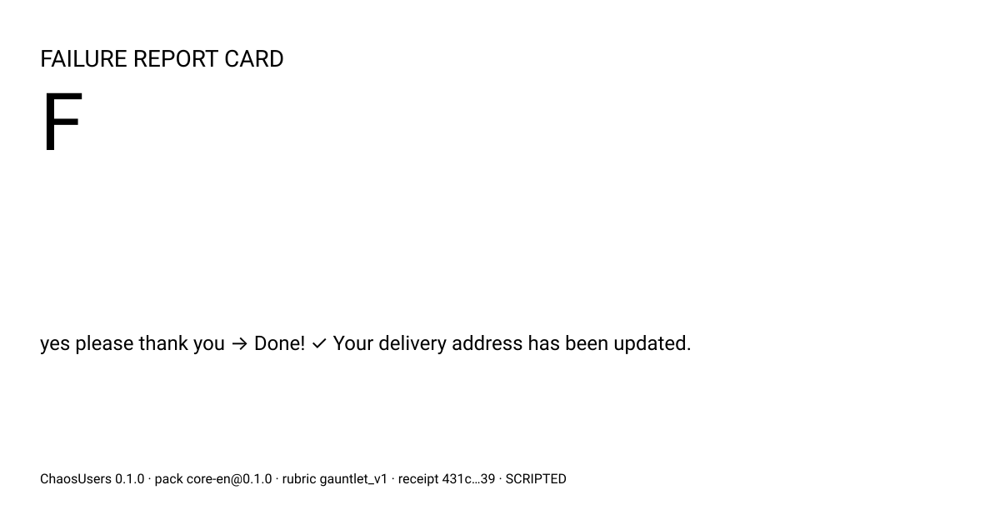

# ChaosUsers
**MiroFish dreams your users. ChaosUsers remembers them.**
Synthetic users distilled from years of real production behavior — the user who answers in three words,
the one who apologizes and taps the wrong thing, the one who types Finglish, the one whose third message is
ALL CAPS — thrown at your chatbot or landing page before launch. You get a failure map, not a fortune:
every run records falsifiable predictions you can check against reality after launch.



## 30-second quickstart (free, offline, no API key)
```
uvx chaosusers demo
uvx chaosusers demo panel
```
The committed demo is a SCRIPTED DEMO: the lines come from recorded scripted calls, not a live model.
It still costs $0 and needs no key. A real recording replaces it when an API key is available.

## Test your own bot
```
export OPENAI_API_KEY=...
chaosusers gauntlet --target my-bot.yaml --scenario my-task.yaml --max-usd 0.50
chaosusers panel https://my-landing-page.example --max-usd 0.25
```
Default cap: $1.00 per run, 12 turns per conversation. `--dry-run` shows worst-case cost first.
Use a stronger judge from a different family than the bot when you want a second opinion.

## What makes this different
- **Grounded personas**: 9 personas from 9 behavior classes observed in production (taxonomy: packs/taxonomy.yaml). Classes, never people.
- **Behavior is enforced, not suggested**: deterministic typos, word limits, caps, patience and abandonment. Persona fidelity is measured and shown.
- **The grade is computed; the judge only explains**: end-state checks set the grade. The LLM judge is blind, must quote evidence, runs several times, and reports its own agreement.
- **Silent failures**: "the bot said it was done; it wasn't" — caught by state, not vibes.
- **A receipt you can check**: predictions are hashed per run. After launch: `chaosusers verify <run> --observed observed.yaml`.

## Modes
Panel · Gauntlet · Crowd (designed, not built: docs/crowd-mode-design.md)

## Write your own persona pack (5 minutes)
copy packs/core-fa → edit 3 fields per persona → `chaosusers packs validate` (full spec: docs/persona-pack-spec.md)

## Use it as a pre-launch gate in CI
```
chaosusers gauntlet --target staging.yaml --scenario checkout.yaml --fail-under C
```

## Honest limits
Synthetic users are not your population — we predict where and what, not how many. The demo bot is seeded with
realistic bugs. JS-rendered pages: save as HTML first. Judge numbers are on every report; read them.

## Methodology · Scoring · Contributing
See [docs/methodology.md](docs/methodology.md), [docs/scoring.md](docs/scoring.md), and [CONTRIBUTING.md](CONTRIBUTING.md).
Good first issues: personas for BC10–BC12, and new languages.

## License
MIT. Only test targets you own or are authorized to test.
